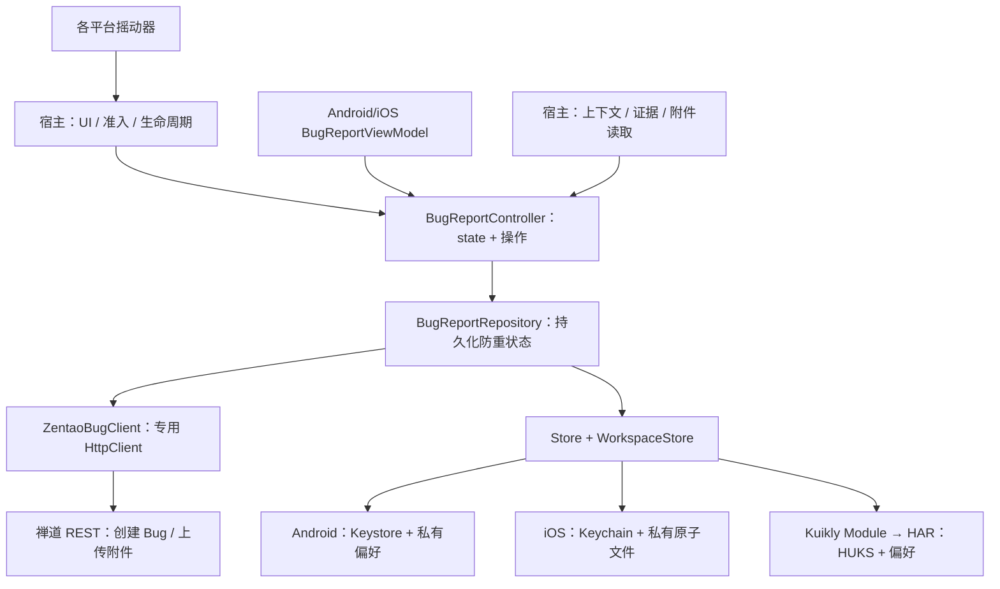
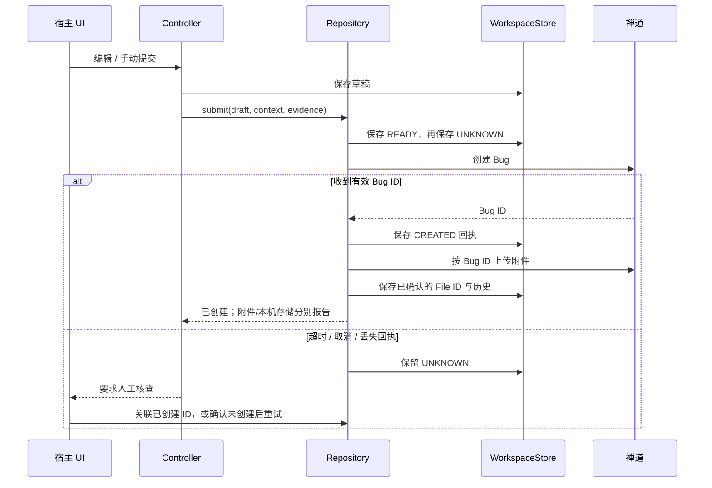
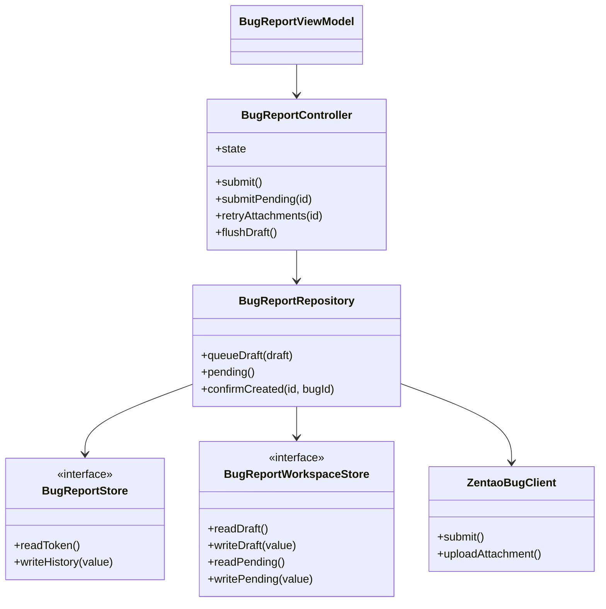

# GY CrossKit Debug Tools

2026-10-25 当前候选为 Maven、已有 Native/Harmony 渠道配套 `1.0.1`；保留已存在的 `1.0.0` 标签与原摘要。下述带日期的 `1.0.0` 准备记录属于历史，本轮源码、归档和公开消费须重新验收，尚未宣称已发布。

当前开发分支的 Kuikly 与宿主统一：KMP 使用 `2.29.1-2.0.21-ohos`，iOS/OHOS Renderer 使用 `2.29.1`。以后随宿主同步升级；本次调整尚未发布，旧版本的接入与验收记录以对应 tag 为准。

Maven / HAR `1.0.1` 正式候选准备中，尚未发布：增加 Android/iOS 同物理存储键判重，防止自定义键覆盖 journal；OHOS 沿用已有判重。保留原生 core、Controller、Android/iOS ViewModel 与 OHOS Kuikly Module，不提供表单 UI。归档、Jenkins 验证、精确公开消费与 HAR Registry 安装均待本轮收据；没有独立 Pod/SPM，旧验收不代算本次候选。

> 2026-10-08 已发布预发行：Maven 0.2.0-rc.6。冻结归档与严格公开产物检查已通过；[精确版本 Release](https://github.com/gycrosskit/debug-tools/releases/tag/0.2.0-rc.6)、[远程消费 CI](https://github.com/gycrosskit/debug-tools/actions/runs/37769707370)分别记录产物和 Android/Native 结果。真实设备、云账号与宿主业务尚未验收。

2026-10-08 功能索引：core提供Controller/REST/存储与传感器，库没有CMP/Kuikly表单UI；A/i宿主消费core，debug-tools-kuikly仅提供OHOS桥。 详见[功能与平台差异](docs/功能与平台差异.md)，含当前三端矩阵、固定历史基线与未验收范围。历史发布组合：Maven 0.2.0-rc.6；OHOS HAR 0.2.0-rc.3。本轮两渠道候选均为 1.0.0，尚未发布。各渠道消费与设备验收分别核对。

Android、iOS、HarmonyOS 共用的 Bug 上报组件：草稿、提交状态、安全 Token、本机历史、摇动触发、页面轨迹、证据格式化和禅道 REST 协议。保留 `com.dgtang.debugtools.bugreport` API；表单 UI、品牌、导航和诊断采集由宿主提供。

历史预发布 Maven **0.2.0-rc.3**（`debug-tools` / `debug-tools-kuikly`）与 Release HAR **0.2.0-rc.3**：初始恢复期间阻止旧快照覆盖新凭据操作，鸿蒙桥严格拒绝 null 和错误参数类型。新标签Release/JitPack文件与新目录Maven实际消费已通过，OHPM仍审核、Release HAR fallback消费已通过，结果见 [完整审查](docs/完整审查.md)；后面的 rc.1/rc.2 为历史验收。

已发布基线 Maven 为 `0.2.0-rc.6`，HAR 保持 `0.2.0-rc.3`；以上 rc.3 为历史说明。rc.6 已将 iOS 摇动冷却改为 CoreMotion 采样的单调时间戳，与 Android/OHOS 同样不受系统时间调整影响；阈值、冷却时长与生命周期保持原合同。

## 本版对齐范围

| 能力 | 当前范围 |
| --- | --- |
| 鸿蒙 Bug 上报 | 共用 Controller/Repository/REST，OHOS KLIB + Kuikly 薄桥 |
| 鸿蒙 Token 存储 | HUKS AES-256-GCM，随机 nonce，普通偏好只保存密文 |
| 鸿蒙摇一摇 | 真实注册回执、阈值/冷却、停止与销毁注销 |
| 三端附件 | 已知 Bug ID 后上传，失败可补传，未知结果先核查 |
| 三端草稿 | 自动保存用户输入，宿主关闭前可等待 flushDraft |
| 三端待提交恢复 | 持久化队列，手动提交；不因启动、联网或授权自动重发 |
| 本地化 | typed notice、内置中文/英文，宿主可映射资源 |

## 架构与调用流程







源码：[共用状态机](src/commonMain/kotlin/com/dgtang/debugtools/bugreport/BugReportController.kt)、[提交与恢复](src/commonMain/kotlin/com/dgtang/debugtools/bugreport/BugReportRepository.kt)、[REST](src/commonMain/kotlin/com/dgtang/debugtools/bugreport/ZentaoBugClient.kt)、[Kuikly 桥](debug-tools-kuikly/src/commonMain/kotlin/com/dgtang/debugtools/kuikly/DebugToolsModule.kt)、[原生 HAR](ohos/debug-tools-native)。

## 支持与安装

| 项目 | 当前范围 |
| --- | --- |
| 平台 | Android minSdk 24、iOS Arm64/Simulator Arm64/x64、OHOS Arm64；JVM 用于共用核心消费和测试 |
| 工具链 | Kotlin `2.2.21-1.0.0`、AGP 8.10.1、Gradle 8.11.1、Android JVM 11；Gradle JDK 17+ |
| 共用依赖 | coroutines `1.10.2-1.0.0`、serialization `1.9.1-1.0.0`、Ktor `3.3.3-1.1.0-04` |
| Android/iOS 包装 | lifecycle-viewmodel 2.10.0；OHOS 核心不依赖 AndroidX |
| 鸿蒙桥 | Kuikly `2.29.1-2.0.21-ohos`，HAR renderer `2.29.1` |
| 原生产物 | Android AAR、iOS/OHOS KLIB、OHOS HAR；没有独立 Pod/SPM/XCFramework |

三端使用 JitPack，配套依赖仓库配置见 [独立消费工程](verification-consumer/settings.gradle.kts)：

```kotlin
implementation("com.github.gycrosskit.debug-tools:debug-tools:1.0.1")
```

三端候选坐标如下（1.0.1 的 JitPack 公开产物与新目录消费待验，设备业务另验）：

```kotlin
commonMain.dependencies {
    implementation("com.github.gycrosskit.debug-tools:debug-tools:1.0.1")
}
ohosArm64Main.dependencies {
    implementation("com.github.gycrosskit.debug-tools:debug-tools-kuikly:1.0.1")
}
```

鸿蒙原生候选包为 `@gycrosskit/debug-tools-native@1.0.1`，尚未发布。以下为 `0.2.0-rc.3` 的历史渠道证据。历史验收时 OHPM 已提交审核，精确版本曾 `NOTFOUND`、`next` 当时指向 rc.1；此为历史记录，不能代替当前 Registry 查询。固定归档为 [不可变 Release HAR](https://github.com/gycrosskit/debug-tools/releases/tag/0.2.0-rc.3)，SHA-256 为 `b65c2028968aa8e2b05b1032fbfdae3c66fe6d6834ebc89e72b2297b5c5da532`；不得把审核提交等同于 registry 已安装。配置、迁移键、手动恢复和生命周期例子见 [接入指南](docs/接入指南.md)；原生注册见 [HAR README](ohos/debug-tools-native/README.md)。

## 最小接入

```kotlin
// engineClient、target、store、hostDataSource 由宿主提供。
val repository = BugReportRepository(ZentaoBugClient(engineClient, target), store)
// Android/iOS 保留现有 ViewModelStore/Koin 所有权。
val model = BugReportViewModel(repository, hostDataSource)
// Kuikly 使用 BugReportController(pageScope, repository, hostDataSource)。
// 观察 state 并调用 openForm、updateTitle、submit 等操作。
```

宿主负责 HTTPS 目标、产品/分支、账号授权 UI、专用 TLS Engine、存储命名空间、证据与附件准入、脱敏、摇动开关、表单与导航。未开通使用 `BugReportTarget.Unavailable`。账号密码不落盘；远端创建成功与附件失败、本机记录失败分别表达。

`BugEvidenceFormatter` 只限长，不脱敏。组件不会自动截图、采集诊断或恢复联网后重发。Android Release 由宿主排除开发依赖；iOS/OHOS 由正式环境准入禁用，不创建或启动调试摇动器。

Controller 操作使用宿主 UI/Page 的串行 scope；Store 的 suspend 签名不代表可以在任意线程访问平台对象。Android/iOS detector 在主线程生命周期调用；Kuikly Store 与摇动使用所属 Page 的协程，销毁在相同 Kuikly Context 调用 `dispose()`。

## 开发与验证

开发命令与历史候选见[开发与验证](docs/开发与验证.md)；发布前执行身份、结果与未验收范围统一见[验证表](docs/功能与平台差异.md#sdk系统与真实验证范围)。历史结果不代表本次文档修正重新执行。

```bash
bash gradlew --no-daemon --max-workers=1 --no-parallel \
  jvmTest testDebugUnitTest iosSimulatorArm64Test \
  compileKotlinIosArm64 compileKotlinIosX64 \
  :debug-tools-kuikly:compileKotlinOhosArm64 publishAllPublicationsToStagingRepository
VERSION=1.0.1 bash scripts/package-maven.sh
```

staging 位于 `build/maven/<版本>`，不用 mavenLocal。候选输出位于 `build/release/<版本>/`，包含 Maven 归档、`SHA256SUMS` 和 `source-receipt.json`；完整 9 个 publications 检查通过后才归档。`export-maven.sh` 沿用同一入口。`verification-consumer` 默认从 JitPack 精确坐标消费；候选可通过外置临时 init script 只替换本组件 group 为 staging。源码、公开消费和设备验收分别记录。

组件权利人授权以 [Apache-2.0](LICENSE) 发布，第三方依赖遵循各自许可证。
[GitHub](https://github.com/gycrosskit/debug-tools) · [Release](https://github.com/gycrosskit/debug-tools/releases) · [Issues](https://github.com/gycrosskit/debug-tools/issues)。反馈只提交脱敏复现信息。

历史候选、归档 SHA 与远程验收见[版本记录](docs/版本记录.md)。

## 自动回归

当前源码回归使用[统一远程验证（Jenkins）](https://github.com/gycrosskit/.github/blob/main/docs/统一远程验证.md)，按已推送源码 ref/SHA 选择对应组件；平台命令与参数以受信 Jenkins recipe 为准。实际执行范围、测试数量、结果与耗时以绑定源码/CI SHA 的构建回执为准，轻量检查或跳过不算平台测试通过。

候选冻结与消费按[发布流程](https://github.com/gycrosskit/.github/blob/main/docs/发布流程.md)使用独立 Job：`component-ci/package` 绑定准确 SOURCE_SHA 生成冻结候选并验证私有消费，`component-ci/release` 绑定准确 Tag/候选执行发布及独立公开消费。核对冻结归档、精确 tag/commit、完整 publication 清单和公开文件，不使用 `mavenLocal`、本库源码或 staging 替换公开依赖；各阶段证据分别记录。

HAR 构建、ohpm Registry 安装、完整原生 SDK 集成和真机业务验收须分别留证，不能由 Maven/KLIB 或其他平台的成功结果代算；本轮覆盖范围以实际 Jenkins 回执为准。

阶段、缓存、有限网络重试、失败记录与证据边界见[共用 CI 规则](https://github.com/gycrosskit/.github/blob/main/docs/持续集成门禁.md)；本库实际平台命令以 Jenkins 的固定版本 recipe 为准。源码通过、远程消费、HAR/ohpm 与设备验收分别记录。

公网核验同步组织 `templates/check-public-maven.py`：使用冻结归档给出的完整 publications 清单，核对 JitPack tag/commit、每个公开 POM/Module、全部声明变体字节大小和四类哈希、内部精确版本及 `available-at`；MD5/SHA-1 sidecar 必须匹配。SHA-256/SHA-512 sidecar 的 HTTP 404 单独输出为渠道缺失，不计为校验通过。

历史 `0.2.0-rc.3` 基线的 JVM JAR 实测 class major 65，需要 Java 21；该基线当时只远程消费 Android/iOS/OHOS，不能把 Android 的 JVM 11 target 或源码 `jvmTest` 成功解释为 JVM 制品兼容。其他版本以其精确制品与消费结果为准。
